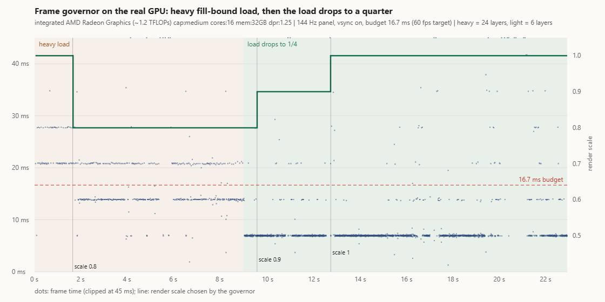

# gfx-core: the shared rendering-engine layer

Branch `perf/gfx-core`. New code only: `src/platform/gfx/**` (11 modules, each with a test file) and `docs/GFX_ENGINE.md` (API reference, integration steps per game, tuning guide, "diagnosing a heavy scene" checklist). Nothing under `src/games/**` or `shared/tiffin-centre/**` was touched: the lead integrates after the merge following `docs/GFX_ENGINE.md` section 4. No new dependencies (three only, where needed).

## What is in it

| module | what it does | tests |
|---|---|---|
| `gpu.js` | renderer string + caps -> `{ class, vendor, model, tflops, tierCap, key }`; a rule table, an integrated GPU never starts on `high` | 160 (70 real strings) |
| `tierMemory.js` | last stable tier + scale per (GPU, viewport class) in one versioned, size-bounded, fully guarded localStorage key; failed tiers remembered | 22 |
| `calibrate.js` | ~250 ms start-up micro-benchmark (fill, draw calls, vertices, half-float post pass), cost model, `recommendTier`, `chooseInitialTier` | 80 |
| `governor.js` | ONE frame governor: scale ladder + tier, up and down, hysteresis, refresh-aware budget, draw-call guard, fps cap hints | 54 |
| `gpuTimer.js` | `EXT_disjoint_timer_query_webgl2` wrapper (frame GPU time; tagged one-off queries for the benchmark) | 8 |
| `loop.js` | rAF loop: fixed step, fps cap, visibility, resize debounce, `renderer.info` handling, zero-allocation stats ring | 22 |
| `dynamicRes.js` | resolution scaling by sub-rect (no target re-allocation): `dynUv()` GLSL, `rewriteSamples`, fullscreen pass, blit | 21 |
| `warmup.js` | `compileAsync` + `initTexture` under a per-frame budget, `warmRender`, program census, material census | 25 |
| `batch.js` | merge by material (world matrix baked, groups kept), `freezeStatic`, tiling, instancing, `disposeTree` | 49 |
| `adaptive.js` | gpu + memory + calibration + governor wired in one call; device hints (battery, data saver) | 14 |
| `index.js` | barrel | (in adaptive) |

455 tests, `npx vitest run src/platform/gfx` (PowerShell), ~3 s. `npx vite build` passes; the whole layer also bundles as a library (98 KB minified for ALL of it; a game imports only what it uses).

## Real-GPU verification

Throwaway harness (scratchpad, not committed) through `scripts/perf/cdp.mjs`: headless Chrome with ANGLE / D3D11 on this laptop's integrated GPU, 1536x864 @ 1.25 (1920x1080 drawing buffer), **vsync on** (the perf scripts' flags turn it off, which hides frame gaps), under the machine-wide bench lock.

**GPU class.** `integrated AMD Radeon Graphics (~1.2 TFLOPs) cap:medium cores:16 mem:32GB dpr:1.25`: classified in 5 ms from the unmasked renderer string; `tierCap` = `medium`, so it can never start on `high`. Browser features seen: `KHR_parallel_shader_compile`, `EXT_color_buffer_float`, `EXT_disjoint_timer_query_webgl2`, WebGL2 sync objects: all present.

**Calibration** (`calibrate.js`, timer mode, 144 Hz panel detected from the frame cadence):

| | run 1 | run 2 (same page, right after) |
|---|---|---|
| total / measure phase | 244 ms / 84 ms (31 frames); a later run 225 ms / 65 ms (28 frames) | 187 ms |
| score (est. fps of a medium-class frame) | 105 | 111 |
| fill / calls / triangles / post | 0.555 ns/px, 3.0 us/call, 1.35 ms/Mtri, 0.69 ns/px | 0.525, 3.5, 1.34, 0.64 |
| recommendation | `medium` at scale 1.0 (est. 9.6 ms of 16.7), confident | same |

The estimate per tier at scale 1 (generic default models): lite 1.3 ms, low 2.3, medium 9.6, high 18.0 (just over the 16.7 budget). Repeatable to ~6 %.

**Frame-time trace during calibration** (rAF gaps, ms; the calibration runs on top of a 60-mesh lit backdrop):

| phase | frames | p50 | p95 | max | gaps > 20 ms |
|---|---|---|---|---|---|
| idle backdrop, before | 89 | 6.9 | 7.0 | 34.8 | 1 |
| **calibration** | 31 | 7.0 | 13.9 | **27.8** | 1 |
| after | 60 | 6.9 | 7.1 | 7.1 | 0 |
| calibration 2 | 27 | 7.0 | 7.0 | 13.8 | 0 |

So it is not perfectly hitch-free, and I will not claim it is: one frame of ~28 ms (4 vsyncs at 144 Hz, 2 at 60 Hz) in the first run. That frame is the first draw of the first program (D3D11 pipeline creation); the idle backdrop's own first frame in the same page stalled 34.8 ms for the same reason, and the second calibration, with the driver warm, never exceeded 13.8 ms. Everything else is one slice of ~3 ms per frame at 144 Hz.

**What went wrong first, and what that taught** (kept because it shaped the design and the guide):
1. v1 timed each slice with a 1-pixel readback. On this machine that is **bimodal**: the same work reads 1.8 ms or 18 ms (the readback queues behind the compositor's own GPU work), and the first timed slice carried first-use costs (18 ms for a 1/16 layer, 33 ms for 40 calls), so it aborted and recommended `lite` on a medium-class machine. Now: two programs only, first draws paid in a "wake" phase one program per frame then a fence poll, slices timed by **GPU timer queries** (nothing blocks the main thread; the calls test uses `max(CPU submit, GPU)`); browsers without the extension get blocking readbacks and a non-confident verdict.
2. A probe run showed **the first draw of every distinct program costs 25-30 ms of main thread on ANGLE / D3D11 even after `compileAsync` resolved** (four programs = four stalls of 26, 26, 28, 33 ms in one frame), while programs drawn ~5 frames after readiness cost ~1 ms. `warmShaders` therefore settles two frames after readiness, and the lever for Autowala's 162 and Tiffin's 311 programs is the NUMBER of programs (the census), not how they are spread.
3. The prepare steps themselves were hitches in JS (a 100k-triangle mesh took 65 ms to build in one step): rebuilt as six small steps with a 12.8k-triangle mesh drawn many times.

**Dynamic resolution** (`dynamicRes.js`, 1024x512 target, painted magenta everywhere first, gradient rendered into the sub-rect, presented on the canvas):

| scale | used sub-rect | max error vs the expected gradient | blue (stale texel) bleed |
|---|---|---|---|
| 1.0 | 1024x512 | 0.002 | 0 |
| 0.8 | 819x410 | 0.002 | 0 |
| 0.5 | 512x256 | 0.002 | 0 |

Cost of one scale step on a 1920x1080 HalfFloat MSAA-4 target (including a clear and a 1-pixel sync readback so the work is really done), 32 steps over the ladder: **re-allocating with `setSize`: 2.2-2.6 ms per step (max 3.9-4.0); moving the viewport: 0.28-0.43 ms (p50 0.2)**, i.e. 6-8x cheaper, with no allocation and no flicker. (Tiffin's profile had `setSize` at 6 % of steady-state CPU.)

**Governor on this GPU** (`governor.js` fed by the real frame loop, `gpuTimer` supported here): a synthetic fill-bound "game" (N layers of the calibration shader drawn through a viewport sub-rect, so cost is proportional to area), N chosen by a sweep so the frame is >= 2x the budget at scale 1 (24 layers = 23.2 ms mean frame), 144 Hz panel, vsync on, budget 16.7 ms (60 fps target), then the load drops to a quarter after 9 s:

Final code (run 5): **converged in 1.65 s** (scale 1 -> 0.8), held it for 7.4 s with **zero reverted attempts**, then after the load dropped it climbed **0.8 -> 0.9 at 9.6 s and 0.9 -> 1.0 at 12.8 s**; no tier change, no oscillation. In the heavy phase the frames at 0.8 alternate between 13.9 and 20.8 ms (two or three 144 Hz refreshes, mean ~18 ms): that is inside the 1.05-1.15 dead band, so the governor does not chase the last 8 % (0.7 would sit on 13.9 ms every frame; it is the price of hysteresis).

The same test on the previous code (run 4) found a real bug and is why the governor changed: it converged in 1.2 s to 0.7, then took two "confident" up-steps (area model: 14.3 ms predicted) that both failed, because on a 144 Hz panel a frame can only take whole multiples of 6.94 ms (14.3 ms of work lands on 20.8 ms); the rung froze after two failures and **when the load dropped to a quarter the scale stayed at 0.7 for 14 s**. Fixes (each with a regression test replaying that trace in the closed-loop simulator): "fits" is judged on whole refresh intervals; failed up-steps are forgiven automatically when the frame time at that rung falls below 75 % of what it was when they failed; the GPU timer reads ~20 % low against the frame, so its headroom estimate is inflated by 1.25.

**Variance, honestly.** The machine is shared with the other streams' benchmarks (the bench lock only serialises benchmarks, not other GPU users), and three runs of the calibration gave score 105, 111 and 72 (fill 0.55, 0.53, 0.74 ns/px): the recommendation (`medium` at scale 1, confident) was the same every time, the numbers move 30-40 %. In run 5 the frame gaps right after the calibration finished contained one 83 ms frame (run 4: max 7.1 ms; cause not isolated: the benchmark's resource disposal, a GC or another process); the calibration's own frames were: p50 6.9 ms, p95 13.9 ms, max 27.8 ms (the first-draw stall described above).

**The no-timer fallback on this GPU** (run 5, the second calibration forced to `timer: false`): the blocking-readback path measured 4.3-7.7 ms for the *smallest* slices (the readback's fixed cost), the first version divided all of it by the tiny work and answered fill 33 ns/px, "lite", `confident: false`, i.e. 60x too pessimistic, which `chooseInitialTier` limits to one tier below the class cap (here `low`). After that run the runner learned to measure the empty readback (smallest of three) and subtract it from every slice; that change is unit-tested only, **not re-measured on the real GPU**.

## What I could not do / what is not proven

- **Nothing here is integrated into a game**, so there is no before / after `bench.mjs` number for Autowala or Tiffin Centre from this stream: the headline numbers above are for the layer itself on the real GPU. The expected game-side effects (no `setSize` per scale step, no oscillation, a correct first tier on an integrated GPU) follow from the measurements above but are the lead's to confirm after integration.
- The calibration's tier models are generic. `docs/GFX_ENGINE.md` 6.1 gives starting models for both games derived from the playbook's draw-call counts; they are **not validated** against `result.recommended.estimates` vs a measured frame time per tier (needs the games integrated).
- The blocking-readback fallback (Safari, Firefox: no `EXT_disjoint_timer_query_webgl2`) is unit-tested only; on this machine's real GPU it was observed to be noisy (see above), which is why its result is never "confident" and may lower the class cap by one tier at most.
- Real-GPU checks ran on ONE machine / one display (144 Hz, integrated AMD). A 60 Hz panel, a discrete GPU and a phone are covered by the unit tests (synthetic traces, 70 renderer strings) only.
- `loop.js` and `adaptive.js` are tested against fakes (clock, rAF, document, storage), not driven by a real page.
- The Autowala `EffectComposer` replacement for dynamic resolution is a documented recipe (5.2), not code: it belongs to aw-gpu's files.

## Risks
- `tierCap` thresholds and the `tflops` figures are rough; they only gate the START tier, and the calibration / governor correct it.
- The governor's headroom estimate trusts `EXT_disjoint_timer_query_webgl2` with a 1.25x bias measured on this machine; a different driver may read differently (the tier-up path is the only consumer and it needs 20 s of calm and reverts on the first miss).
- Merging (`batch.js`) is only safe for geometry that never moves; the helpers refuse skinned / instanced / morph / transparent / `noMerge` objects, but a mesh that something moves WITHOUT flagging it will freeze in place (use `skip` / `userData.noMerge`).
